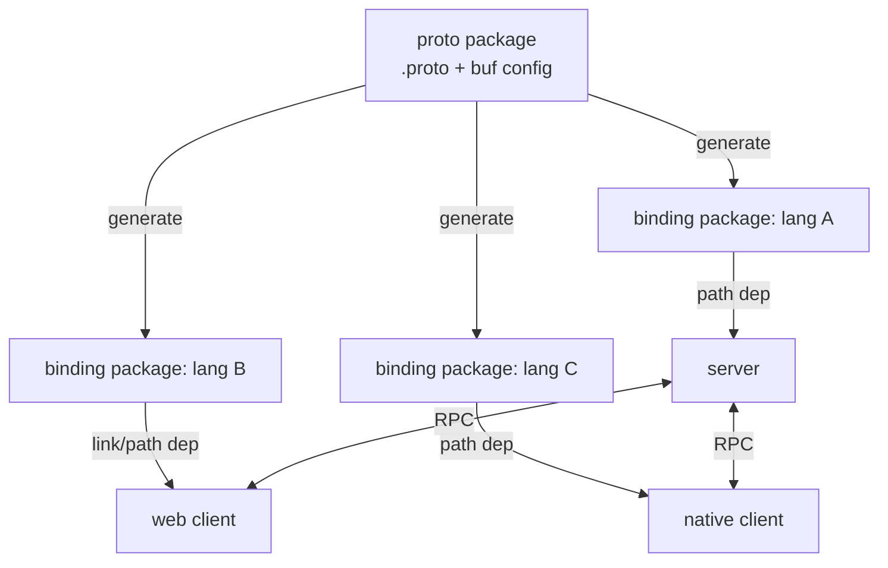

This is a structural pattern, not one project's history. It generalizes what
worked in a production monorepo (a Rust server, a SwiftUI client, a Svelte
client, protobuf as the contract between them) into a template for starting a
*new* project in the same shape. Where a concrete choice from that project is
cited as an example, it is labeled as such — copy the pattern, not necessarily
the language or library.

Use this pattern when: one server owns domain logic, two or more native clients
need to talk to it over a stable wire contract, and you want each language's own
build tooling (Cargo, SwiftPM, pnpm/Vite, …) rather than a second hermetic
dependency graph layered on top.

## Package layout

One directory per package under `packages/`, regardless of language. The repo
root holds only repo-wide orchestration config — a root `mise.toml`, a root
`hk.pkl`, editor/format config (`.editorconfig`, `.typos.toml`) — never product
code.

```text
packages/
  <name>-proto/              schema package — source of truth, buf config, no product code
  <name>-proto-<lang>/       one per consuming language — generated bindings + one hand-written entrypoint
  <name>-server/             the backend owning domain logic
  <name>-<client>/           one per native client (iOS, web, …)
docs/
  architecture.md            the mechanism
  adr/                       the why, one file per decision
```

Every product package owns its own dependency manifest, lockfile, `mise.toml`,
and `hk.pkl`. There is no root Cargo workspace and no root pnpm workspace —
packages link to each other by relative path (`path = "../foo"`, `link:../foo`,
local SwiftPM path dependency), and the schema package is the one exception: it
has no manifest or lockfile of its own, because there is nothing to install — it
is `.proto` files plus codegen config.



## The protobuf-contract pattern

The schema package (e.g. `sophia-proto`) holds `.proto` files and codegen config
and nothing else derived. One codegen invocation (`buf generate`, or your
generator's equivalent) fans out into every consuming language's binding
package, writing into a directory that is:

- **always the same name** across every binding package (pick one, e.g.
  `generated`; avoid a name that collides with a language keyword — `gen` is
  reserved in Rust 2024, which is why the sophia project uses `generated`),
- **gitignored**, and
- **wiped and rewritten on every generation run** (`clean: true` or equivalent)
  — a hand-edit inside it is silently destroyed on the next run.

Each binding package has **exactly one hand-written file** that wraps the
generated tree and re-exports it under the stable import path consumers actually
use. This is the seam that lets the generator's raw output be replaced without
touching consumers:

| Language | Hand-written entrypoint | Pattern |
| --- | --- | --- |
| Rust | `src/lib.rs` | `include!`s the generated modules, re-exports flat under a clean namespace. Crate name and `[lib] name` MAY differ — document which one consumers actually import. |
| TypeScript | `src/index.ts` | `export * from` each generated file; package ships source directly via its `exports` map rather than a compiled `dist/`. |
| Swift | `Package.swift` | If the SwiftPM target's `path` points straight at the generated directory, there is no separate re-export file — the generated code *is* the module, and consumers see the generator's own type names. |

Wire every consuming package's `build` task to depend on the schema package's
`generate` task, so a clean checkout materializes bindings before anything
compiles. Pin each binding package's runtime support library (protobuf runtime,
RPC runtime) to the exact version the codegen plugin targets — a
generator/runtime version skew is a common, confusing failure mode. Run a
schema-compatibility check (e.g. `buf breaking`) against the trunk branch in CI:
an old client build in the field will keep talking to a new server, so breaking
the wire contract is worse than breaking a compile.

**Recommended, not required:** constrain every RPC to one of two shapes — unary
request/response for commands, and at most one server-streaming "watch" RPC per
state a client needs to follow live. No client-streaming, no bidirectional
streams. This keeps every client's transport code identical in shape and avoids
the reconnect/resume complexity bidi streaming invites.

## mise: monorepo task orchestration

Root `mise.toml` sets `monorepo_root = true` and
`config_roots = ["packages/*"]`, so mise discovers every package's own
`mise.toml`. The root composes standard workflows by declaring `depends` on
namespaced package tasks — it does not reimplement package logic:

```toml
[tasks.build]
depends = ["//packages/<name>-proto:build", "//packages/<name>-server:build", "//packages/<name>-web:build"]
```

Host-conditional packages (an Xcode-only client, say) are added via a templated
`run` block guarded on `os()`, so the same root task works on a CI runner that
cannot build them.

Standard task names per package: `build`, `check`, `fix`, and where applicable
`test`, `dev`. **`check` composes whatever validation that specific package
actually needs — do not assume it uniformly depends on `test`.** A schema-only
or type-check-only package with no test suite wires `check` to depend on
`build`; a package with a real test suite wires `check` to depend on `test`; a
package with a separate type-checker (e.g. `svelte-check`/`tsc` alongside a test
runner) wires `check` to depend on both `test` and its own `typecheck` task.
Look at what the package actually has before writing its `check` task, not what
a sibling package has.

Every generated-binding package's `build`/`check`/`fix` depends on the schema
package's `generate` task (directly, or transitively through its own `build`).
Force regeneration by name: `mise run //packages/<name>-proto:generate`.

Each package declares a tracked dependency provider (`[deps.cargo]`,
`[deps.pnpm]`, `[deps.swiftpm]`, …) with `auto = true`, so
`cargo fetch`/`pnpm install --frozen-lockfile`/ `swift package resolve` runs
automatically when that package's manifest or lockfile changes — contributors
never run an install command by hand.

Namespaced invocation works from anywhere
(`mise run //packages/<name>-web:check`); the unqualified form works from inside
a package directory (`mise run :build`).

Pin every tool a task invokes in that package's own `[tools]` block, with a root
`mise.lock`. **Never invoke a tool that isn't pinned** — add the pin to the
package that owns the task, so local runs and CI agree.

## hk: lint/format composition

Root `hk.pkl` sets `subprojects = List("packages/*")`, which merges every
package's own `hk.pkl` linters into repository-wide git hooks while keeping each
package's hooks independently runnable (`hk check --all` inside just that
package directory still works). The root owns only generic, language-agnostic
steps — formatting TOML, catching merge conflicts and private keys, linting CI
workflow files, catching mixed line endings, spell-checking.

Each package owns its own language-specific `linters` mapping of named `Step`s
(formatter, linter), wired into `check`, `pre-commit`, and `fix` hooks.
Conventions worth keeping, none of them universal:

- exclude the generated-bindings directory from every linter in a binding
  package — it's regenerated, not hand-maintained, and different generators
  produce line lengths/patterns linters shouldn't fight;
- there's no single required naming convention for custom step ids (hyphenated
  vs. underscored) — pick one and stay consistent within a package, and check
  the package's own `hk.pkl` rather than assuming another package's spelling;
- `pre-commit` MAY auto-fix with `fix = true` and `stash = "git"` (stash
  unstaged changes so the fixer only sees staged content) — decide this per
  package based on whether its formatter is safe to run unattended on a commit.
- never call the underlying linter/formatter binary directly if the package
  wraps it in a task runner (e.g. a bundled `vp`/build-tool CLI) — go through
  that wrapper, so its project config is actually applied.

## Server package

One package owns domain logic end-to-end: reconciling/deriving state, talking to
whatever external systems the product integrates with, and serving the RPC
contract generated by the schema package. Conventions worth keeping from a Rust
example of this shape:

- forbid unsafe code and ban `unwrap`/`expect`/`panic`/`todo` at the lint level
  if the language supports it, so failure paths are typed, not process-crashing;
- put every external-system integration behind one trait/interface so protocol
  quirks never leak into core logic, and so a new integration is additive, not a
  core-logic change;
- if the server's job is literally "converge state toward a goal" (a
  reconciler), keep the event-driven and state-driven halves separate: inputs
  only enqueue *which* thing needs attention, never *what to do about it* — a
  component reads full current state and decides, every time, so restarts,
  duplicate events, and reordered events are all harmless by construction;
- a server-streaming "watch" RPC should send a full snapshot on every
  (re)connect, then deltas — no resume protocol. This is simpler to implement
  correctly than resumable streaming and is what makes "client reconnected" and
  "client started cold" the same code path;
- prefer inline `#[cfg(test)] mod tests` (or the language's equivalent)
  colocated with the code under test over a separate integration-test tree,
  unless a test genuinely needs to exercise multiple packages together;
- if a test needs real external hardware/services, gate it out of the default
  test run by name or attribute, and say so in the test itself — don't let CI
  depend on hardware it doesn't have.

## Native clients

**Split logic from the platform's heavyweight UI toolchain when that toolchain
requires an IDE the CLI can't provide.** A SwiftUI client built on Apple
platforms is the clearest case: put everything that doesn't import `SwiftUI`
(state model, sync/reducer logic, geometry, caching, the outbound write queue)
into a plain library target that builds and tests with the bare command-line
toolchain (`swift build`/`swift test`), and keep SwiftUI views in a separate
target that only the generated IDE project compiles. Confine any single-purpose,
IDE-only framework import (ARKit, RealityKit, a platform's weather/maps kit) to
the one view file that needs it, so adding a feature there can never silently
break the headless test run.

**Generate the IDE project file from a declarative spec, and gitignore the
generated project.** (Example: XcodeGen's `project.yml` → `.xcodeproj`.)
Regenerate after adding a source file or editing the spec — a new file added
straight to the filesystem is invisible to the IDE until then. Explicitly
declare anything the generator would otherwise auto-create and put in a
gitignored, per-developer location (build schemes are the classic case).

**State-stream consumption is symmetric across every client:** open the
server-streaming RPC, render the snapshot, apply deltas through a pure reducer,
and on any transport failure, tear down and reopen — re-fetching a fresh
snapshot rather than attempting to resume. Treat foregrounding/network-change
the same as a cold start; on mobile in particular, the OS killing your socket in
the background is not an edge case, it's the common path.

**An offline write queue stores desired values, not actions**, and has no expiry
by default — a queued "set brightness to 50%" replays as "set brightness to 50%"
whenever connectivity returns, never as a replayed button tap. Give any
optimistic local overlay an explicit rule for when the server's authoritative
state supersedes it (e.g., a monotonic revision/watermark the write carries and
the overlay releases once the stream's revision has passed it).

## Web client

Don't assume a router, a CSS framework, or a 3D rendering library are required —
add each only when an actual product need appears. A single-view or few-view app
can switch views with local component state instead of a router; a small,
explicit CSS custom-property vocabulary can stand in for a design-system
dependency; hand-rolled SVG/canvas can stand in for a 3D library when the
content really is 2D. If the client does grow enough views to need real routing,
that's an architectural addition — add a router deliberately and document the
route table, rather than letting ad hoc view-switching state sprawl.

Keep one reactive store as the single source of transport-derived state, fed by
a pure reducer function that folds each stream message into it — the reducer
should be unit-testable with zero DOM/framework dependencies. Mirror the same
reducer shape across every client language so a contributor who understands one
understands the others.

## Documentation

- `README.md` — what the system is, the shape-of-the-system table, and the
  handful of commands to get running. Tables over prose for choices made.
- `docs/architecture.md` — the *mechanism*: how the pieces fit together, state
  model, the core loop, integration/extension boundary. Diagram the system
  shape; tabulate any status/state enum.
- `docs/adr/NNNN-kebab-title.md` — the *why* behind each major decision, one
  file per decision, a fixed template (Status, Date, Context, Decision,
  Consequences, and what would reverse it). Record superseding in a later ADR's
  Status line, never by deleting the old one.
- `docs/roadmap.md` (optional) — phased plan ordered by risk, not feature
  appeal.
- A domain-reference doc (optional) — per-integration/per-subsystem notes, each
  claim dated and sourced, anything unverified against the real thing explicitly
  marked so.
- `AGENTS.md` at the repo root — the commands and the non-negotiable invariants
  a contributor (human or agent) must not violate. State invariants as
  consequences ("if you do X, Y breaks"), not style preferences.

## Bootstrap checklist for a new project in this shape

1. Create the schema package: `.proto` files, lint/breaking config, codegen
   config targeting one `generated`-named, gitignored output directory per
   consuming language's sibling package.
2. Create one binding package per consuming language. Write its single
   entrypoint file before generating anything, wire its `build` to depend on the
   schema package's `generate` task.
3. Root `mise.toml`: `monorepo_root = true`, `config_roots = ["packages/*"]`,
   compose `build`/ `check`/`fix`/`test`/`dev` over the packages that exist so
   far.
4. Root `hk.pkl`: `subprojects = List("packages/*")`, plus whatever repo-wide,
   language-agnostic steps you want everywhere.
5. Create the server package: depend on your own-language binding package,
   implement the integration boundary trait/interface, wire up the RPC service
   implementations, add its `mise.toml`/`hk.pkl`.
6. Create each native client package: depend on its language's binding package,
   apply the logic/UI split if its platform needs one, wire its
   `mise.toml`/`hk.pkl`.
7. Wire CI: a cross-platform job (build + check on the portable packages), a
   schema compatibility job (breaking-change check against trunk), and one job
   per platform-constrained client (e.g. an Xcode client needs a macOS runner).
8. Write `docs/architecture.md` and the first ADR (why this stack) before
   writing much product code — it's cheaper to write down the shape while you're
   deciding it than to reconstruct it later.

## Worked example

The sophia project (a local-first home-automation server) follows this pattern
with: a Rust server (`sophia-server`) using `buffa`/`connectrpc` over the
generated bindings, a schema package (`sophia-proto`) using `buf` with remote
BSR plugins, three binding packages (`sophia-proto-rust`,
`sophia-proto-typescript`, `sophia-proto-swift`), a SwiftUI client split into a
headless `SophiaKit` library and an XcodeGen-generated app shell, and a Svelte 5
web client driven by a Vite-based task runner (`vp`). Its `docs/architecture.md`
and `docs/adr/` are worth reading as a concrete instance of the documentation
conventions above — but its specific dependency versions, module names, and
domain invariants (desired-state reconciliation, confirmation tiers) are that
project's choices, not part of this pattern.
